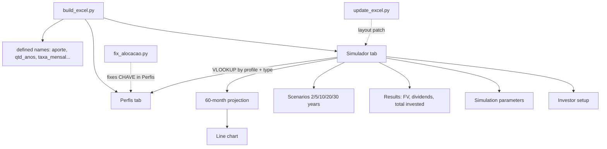

# excel-para-investimentos

**English** · [Português (Brasil)](README.md)

  

## What it is

A real estate fund (FII) investment simulator built as an Excel workbook generated by a Python script. The workbook projects accumulated equity, monthly dividends and how the monthly contribution splits across FII types according to the investor's risk profile.

## Status

Working. `build_excel.py` generates `Simulador_FII.xlsx` with the **Simulador** and **Perfis** tabs; the committed workbook is that output. There are no automated tests.

## Features

- **Investor setup**: salary, average portfolio yield and a suggested contribution of 30% of the salary.
- **Simulation parameters**: monthly contribution, horizon in years and monthly appreciation rate.
- **Formula-driven results**: accumulated equity (`FV`), estimated monthly dividends, total actually invested and accumulated interest.
- **Scenarios**: equity and monthly dividend at 2, 5, 10, 20 and 30 years.
- **Monthly projection**: 60-row table with equity month by month, used as the chart source.
- **Line chart**: equity evolution for the first 60 months.
- **Allocation by profile**: PAPEL, TIJOLO, HÍBRIDOS, FOFs, DESENVOLVIMENTO and HOTELARIAS, with percentage and monthly amount per type.
- **Perfis tab**: reference table with 3 profiles (Conservative, Moderate, Aggressive) × 6 FII types, read through `VLOOKUP`.
- **Named ranges**: `aporte`, `qtd_anos`, `taxa_mensal`, `patrimonio`, `rendimento_carteira` and others keep formulas readable.

## Architecture



The flow is: `build_excel.py` builds the whole workbook; `update_excel.py` and `fix_alocacao.py` are correction steps applied **afterwards**, against an intermediate version of the file (see Limitations).

## Stack

- Python 3
- `openpyxl` (styles, data validation, charts, named ranges)
- Excel / LibreOffice to open and simulate

## Repository structure

```
excel-para-investimentos/
├── build_excel.py             # generates Simulador_FII.xlsx (Simulador + Perfis)
├── update_excel.py            # patch: profile dropdown, columns and chart
├── fix_alocacao.py            # patch: guarantees the CHAVE column in Perfis
├── Simulador_FII.xlsx         # committed output
├── contexto do desafio.txt    # DIO challenge statement
├── LICENSE                    # MIT
├── README.md                  # Portuguese version
└── README.en.md               # this file
```

## Prerequisites and installation

Python 3 and `openpyxl`:

```bash
pip install openpyxl
```

There is no `requirements.txt`; `openpyxl` is the only dependency.

## How to run

```bash
python build_excel.py
```

This recreates `Simulador_FII.xlsx` with the **Simulador** and **Perfis** tabs. Open the file and edit only the input cells (salary, contribution, horizon, rate, profile): result cells are formulas.

`update_excel.py` and `fix_alocacao.py` are historical. `fix_alocacao.py` still runs against the current workbook (it rewrites the `CHAVE` column in Perfis). `update_excel.py` does **not** run against the freshly generated file: it writes to merged cells and ends with `AttributeError: 'MergedCell' object attribute 'value' is read-only`.

## Tests and quality

There are no automated tests. Manual verification performed:

- `python build_excel.py` → `Simulador_FII.xlsx` created, tabs `['Simulador', 'Perfis']`.
- `python fix_alocacao.py` → finishes without errors.
- `python update_excel.py` → fails with `AttributeError` on a merged cell (patch for an earlier layout).

## Technical decisions and trade-offs

- **Excel formulas instead of Python calculations**: the user changes the contribution and sees the result immediately, without running anything; in exchange, values cannot be verified without opening Excel.
- **Named ranges**: `=FV(taxa_mensal,qtd_anos*12,aporte*-1)` is readable and survives row changes; in exchange, names must stay in sync with the cells.
- **Profiles in a separate tab + `VLOOKUP`**: the allocation table becomes editable data; in exchange, the composite `PROFILE-TYPE` key must be filled (the job of `fix_alocacao.py`).
- **Patch scripts instead of a single generator**: each layout adjustment is preserved as a script; in exchange, execution order matters and the older patch breaks on the current layout.
- **Native `openpyxl` chart**: no external image and it updates with the data; in exchange, styling is limited to what the library exposes.

## Known limitations and roadmap

- `update_excel.py` targets an intermediate layout (dropdown at `H21`, columns `D`/`E` from row 28) and fails on the layout produced by `build_excel.py`, where the profile selector sits at `C92` and the projection starts at row 29.
- The profile at `C92` is free text in the workbook generated by `build_excel.py`; the dropdown only exists in the old patch.
- The 1.079% monthly appreciation rate is an example value, not a market projection.
- No automated tests.
- Roadmap: consolidate the three scripts into one idempotent generator, move the profile selector into a validated cell and cover the formulas with read-back tests through `openpyxl`.

## Development process

An individual project by Kelvin Oliveira for a DIO challenge, built with AI agents and reviewed by the author. The scope came from `contexto do desafio.txt`; the workbook was assembled in steps (generation, allocation fix, layout refinement).

## License and author

[MIT](LICENSE).

**Author**: [Kelvin Oliveira](https://github.com/KelvinOliveiraCode) · [Portfolio](https://kelvinoliveiracode.github.io/portfolio/)
