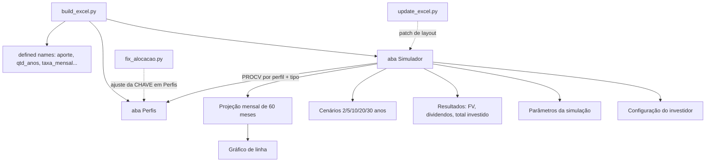

# excel-para-investimentos

[English](README.en.md) · **Português (Brasil)**

  

## O que é

Simulador de investimentos em Fundos de Investimento Imobiliário (FII) construído como planilha Excel gerada por script Python. A planilha projeta patrimônio acumulado, dividendos mensais e a divisão do aporte por tipo de FII conforme o perfil de risco do investidor.

## Status

Funcional. `build_excel.py` gera `Simulador_FII.xlsx` com as abas **Simulador** e **Perfis**; o arquivo versionado no repositório é essa saída. Não há testes automatizados.

## Funcionalidades

- **Configuração do investidor**: salário, rendimento médio da carteira e sugestão de aporte de 30% do salário.
- **Parâmetros da simulação**: aporte mensal, prazo em anos e taxa de valorização mensal.
- **Resultados por fórmula**: patrimônio acumulado (`FV`), dividendos mensais estimados, total efetivamente investido e juros acumulados.
- **Cenários**: patrimônio e dividendo mensal em 2, 5, 10, 20 e 30 anos.
- **Projeção mensal**: tabela de 60 meses com o patrimônio mês a mês, usada como fonte do gráfico.
- **Gráfico de linha**: evolução do patrimônio nos primeiros 60 meses.
- **Alocação por perfil**: tabela com PAPEL, TIJOLO, HÍBRIDOS, FOFs, DESENVOLVIMENTO e HOTELARIAS, com percentual e valor mensal por tipo.
- **Aba Perfis**: tabela de referência com 3 perfis (Conservador, Moderado, Agressivo) × 6 tipos de FII, consultada por `PROCV`.
- **Ranges nomeados**: `aporte`, `qtd_anos`, `taxa_mensal`, `patrimonio`, `rendimento_carteira`, entre outros, deixam as fórmulas legíveis.

## Arquitetura



O fluxo é: `build_excel.py` cria a planilha inteira; `update_excel.py` e `fix_alocacao.py` são passos de correção aplicados **depois**, sobre uma versão intermediária do arquivo (ver Limitações).

## Stack

- Python 3
- `openpyxl` (estilos, validação de dados, gráficos, ranges nomeados)
- Excel / LibreOffice para abrir e simular

## Estrutura do repositório

```
excel-para-investimentos/
├── build_excel.py             # gera Simulador_FII.xlsx (Simulador + Perfis)
├── update_excel.py            # patch: dropdown de perfil, colunas e gráfico
├── fix_alocacao.py            # patch: garante a coluna CHAVE da aba Perfis
├── Simulador_FII.xlsx         # saída versionada
├── contexto do desafio.txt    # enunciado do desafio DIO
├── LICENSE                    # MIT
├── README.md                  # este arquivo
└── README.en.md               # versão em inglês
```

## Pré-requisitos e instalação

Python 3 e `openpyxl`:

```bash
pip install openpyxl
```

Não há `requirements.txt`; `openpyxl` é a única dependência.

## Como executar

```bash
python build_excel.py
```

Isso recria `Simulador_FII.xlsx` com as abas **Simulador** e **Perfis**. Abra o arquivo e edite apenas as células de entrada (salário, aporte, prazo, taxa, perfil): os campos de resultado são fórmulas.

Os scripts `update_excel.py` e `fix_alocacao.py` são históricos. `fix_alocacao.py` ainda roda sobre o arquivo atual (regrava a coluna `CHAVE` da aba Perfis). `update_excel.py` **não** roda sobre o arquivo recém-gerado: ele tenta escrever em células mescladas e termina com `AttributeError: 'MergedCell' object attribute 'value' is read-only`.

## Testes e qualidade

Não há testes automatizados. Verificação manual executada:

- `python build_excel.py` → `Simulador_FII.xlsx` criado, abas `['Simulador', 'Perfis']`.
- `python fix_alocacao.py` → conclui sem erro.
- `python update_excel.py` → falha com `AttributeError` em célula mesclada (patch de uma versão anterior do layout).

## Decisões técnicas e trade-offs

- **Fórmulas do Excel em vez de cálculo no Python**: o usuário muda o aporte e vê o resultado na hora, sem rodar nada; em troca, os valores não são verificáveis sem abrir o Excel.
- **Ranges nomeados**: `=FV(taxa_mensal,qtd_anos*12,aporte*-1)` é legível e sobrevive a mudanças de linha; em troca, nomes precisam ser mantidos em sincronia com as células.
- **Perfis em aba separada + `PROCV`**: a tabela de alocação vira dado editável; em troca, a chave composta `PERFIL-TIPO` precisa estar preenchida (papel do `fix_alocacao.py`).
- **Scripts de patch em vez de um gerador único**: cada ajuste de layout ficou registrado como script; em troca, a ordem de execução importa e o patch mais antigo quebra no layout atual.
- **Gráfico nativo do `openpyxl`**: sem imagem externa e atualiza com os dados; em troca, o estilo é limitado ao que a biblioteca expõe.

## Limitações conhecidas e roadmap

- `update_excel.py` mira um layout intermediário (dropdown em `H21`, colunas `D`/`E` a partir da linha 28) e falha no layout atual gerado por `build_excel.py`, onde o seletor de perfil fica em `C92` e a projeção começa na linha 29.
- O perfil em `C92` é texto livre no arquivo gerado pelo `build_excel.py`; a lista suspensa só existe no patch antigo.
- Taxa de valorização de 1,079% ao mês é um valor de exemplo, não uma projeção de mercado.
- Sem testes automatizados.
- Roadmap: consolidar os três scripts em um gerador idempotente, mover o seletor de perfil para uma célula validada e cobrir as fórmulas com testes de leitura via `openpyxl`.

## Processo de desenvolvimento

Projeto individual de Kelvin Oliveira para um desafio da DIO, construído com apoio de agentes de IA e revisado pelo autor. O escopo veio de `contexto do desafio.txt`; a planilha foi montada em etapas (geração, ajuste de alocação, refinamento de layout).

## Licença e autor

[MIT](LICENSE).

**Autor**: [Kelvin Oliveira](https://github.com/KelvinOliveiraCode) · [Portfólio](https://kelvinoliveiracode.github.io/portfolio/)
